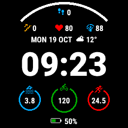

#  Garmin Triathlon Training WatchFace

A custom watchface developed in Monkey C for Garmin Connect IQ devices, designed to track training volumes in real time across the three triathlon disciplines (swimming, cycling, and running) during athletic preparation blocks.

---

## Table of Contents

1. [Project Overview](#project-overview)
   - [The Problem and Motivation](#the-problem-and-motivation)
   - [Technical Solution](#technical-solution)
   - [Built With](#built-with)
2. [Key Features](#key-features)
3. [Architecture and Engineering Choices](#architecture-and-engineering-choices)
4. [Getting Started](#getting-started)
   - [User Installation](#user-installation)
   - [Building from Source (Developers)](#building-from-source-developers)
5. [Usage and Configuration](#usage-and-configuration)
6. [Repository Structure](#repository-structure)
7. [Contributing](#contributing)
8. [License](#license)

---

## Project Overview

<p align="center">
  
</p>

### The Problem and Motivation

This project grew out of a personal need I ran into while training for a triathlon race. During the months of specific preparation, I wanted an easy way to keep track of the total volume accumulated in each discipline: how many meters I swam, how many kilometers I rode, and how many I ran over the course of the week or training block—much like single-sport runners often do.

While browsing the Garmin Connect IQ Store, I noticed that almost every existing watchface focuses exclusively on standard daily metrics (steps, 24-hour calories burned, heart rate, weather) or only displays weekly running mileage. For a triathlete, checking the totals across all three disciplines requires either digging through multiple watch submenus or opening the Garmin Connect app on a smartphone every single time.

I wanted a tool that cut out those steps: a clean, readable watchface that shows the work done so far at a glance. Beyond the practical utility, there is a strong motivational aspect to it: watching the distance counters across the three disciplines climb day after day, week after week, gives an immediate and tangible sense of satisfaction for your consistency during the toughest training blocks.

So I built the watchface I wished existed.

### Technical Solution

The software queries the internal activity database stored on the watch directly via the `Toybox.UserProfile` API, filtering sessions by sport type (`SPORT_SWIMMING`, `SPORT_CYCLING`, `SPORT_RUNNING`, including indoor variants like smart trainers and treadmills) and aggregating distances locally without relying on external services or continuous Bluetooth connections. The user interface was designed to maximize contrast and readability both under direct sunlight (transflective MIP displays) and on AMOLED panels, while keeping battery impact to a minimum.

### Built With

* **Language:** [Monkey C](https://developer.garmin.com/connect-iq/monkey-c/) (Garmin's proprietary object-oriented language)
* **Framework / SDK:** [Garmin Connect IQ SDK](https://developer.garmin.com/connect-iq/sdk/) (API Level 3.2.0+)
* **Build System:** Monkey C Compiler (`monkeyc`) and target management via `monkey.jungle` configuration files
* **Layout & Resources:** Declarative XML for multi-resolution management of fonts, strings, user settings, and vector/bitmap drawables

---

## Key Features

* **Multi-Disciplinary Cumulative Tracking (Swim / Bike / Run):** Automatic calculation and separate display of training volumes for swimming, cycling, and running accumulated over the selected time window, extracted directly from the device's local history (`UserActivityHistory`).
* **Visual Progress Indicators:** Dynamic progress bars or rings linked to each discipline, configurable based on your weekly or training-block mileage goals.
* **Physiological and Recovery Metrics:** Integrated display of key parameters for high-volume training:
  * Real-time and resting heart rate (HR).
  * Device battery status and Body Battery / estimated recovery time (on compatible devices).
  * Daily step counter, active/total calories, and weekly intensity minutes.
* **Advanced Power Management (Low-Power Mode):** Differentiated rendering architecture between active state (*High Power Mode*, triggered on wrist gesture) and standby state (*Low Power Mode*). In standby, per-second updates are disabled and recalculation cycles are reduced to preserve battery life during long training weeks.
* **AMOLED Burn-in Protection:** Periodic pixel-shifting implementation and active pixel luminance limiting during Always-On Display mode, complying with Garmin hardware guidelines.
* **Full Customization via Garmin Connect Mobile:** Configure settings directly from your smartphone:
  * Distance targets for swim, bike, and run.
  * Data aggregation time window (e.g., current week starting Monday, rolling last 7 days, or monthly/training block total).
  * Independent measurement units (kilometers or miles for run and bike; meters or yards for swim).
  * Time format (12h / 24h) and date localization.
  * High-contrast color themes to match visual preferences and display technology.

---

## Architecture and Engineering Choices

Developing for embedded wearable devices like Garmin sportwatches involves strict constraints in terms of available RAM (often between 64 KB and 124 KB for a single watchface) and CPU cycles.

The following design solutions were implemented during development:

1. **Activity History Caching and Asynchronous Updates:** Iterating over `UserProfile.getUserActivityIterator()` is a computationally expensive operation. Instead of recalculating total distances on every `onUpdate(dc)` call (which runs every second in active mode), the history scan is only performed upon view initialization (`onLayout` / `onShow`) or when waking up from sleep (`onExitSleep`), caching the results in memory state variables.
2. **Graphics Buffering and Clipping (`onPartialUpdate`):** To keep the watchface responsive without draining the battery, static elements (discipline icons, separator grids, progress rings) are drawn separately from dynamic text like time and heart rate, using clipping regions (`dc.setClip`) to redraw only the screen areas that actually change.
3. **Multi-Device Adaptability (Responsive Layout):** Garmin devices come in very different resolutions, shapes (round, semi-octagonal, rectangular), and sizes (e.g., from $240\times 240$ pixels on Forerunner 245/745 models up to $454\times 454$ pixels on Fenix 8 / Forerunner 965 models). Element positioning along the $(x,y)$ axes avoids hardcoded coordinates and is instead calculated dynamically as a percentage of the `Dc` (Device Context) dimensions read at runtime via `dc.getWidth()` and `dc.getHeight()`.

---

## Getting Started

### User Installation

If you simply want to install the watchface on your Garmin watch:

1. **Via Connect IQ Store (Recommended):** Search for the watchface name on the Garmin Connect IQ Store app and tap *Install*.
2. **Manual Installation (Sideloading):**
   * Download the latest `.prg` binary file from the [Releases](../../releases) section of this repository.
   * Connect your Garmin watch to your computer via USB cable.
   * Copy the `.prg` file into the `/GARMIN/APPS/` folder on the watch's internal storage.
   * Disconnect the device: the watchface will be immediately available in the watch's *Watch Face* menu.

### Building from Source (Developers)

1. Clone this repository locally:

```sh
git clone https://github.com/your-username/garmin-triathlon-watchface.git
cd garmin-triathlon-watchface
```

2. Generate a developer signing key (if you don't already have one):

```sh
openssl genrsa -out developer_key.pem 4096
openssl pkcs8 -topk8 -inform PEM -outform DER -in developer_key.pem -out developer_key.der -nocrypt
```

3. Compile the project for a specific target device (e.g., `forerunner965` or `fenix7`) using the `monkeyc` command-line compiler (or via the `Monkey C: Build for Device` command in VS Code):

```sh
monkeyc -d forerunner965 -f monkey.jungle -o bin/TriathlonWatchFace.prg -y /path/to/your/developer_key.der -w
```

4. Launch the Connect IQ simulator and load the compiled executable:

```sh
connectiq &
monkeydo bin/TriathlonWatchFace.prg forerunner965
```

---

## Usage and Configuration

Once installed and set as your primary watchface, it automatically reads the latest activities saved on the watch and populates the Swim, Bike, and Run counters.

To customize parameters via the **Garmin Connect IQ** smartphone app:

1. Open the Connect IQ app, go to *My Device* -> *My Watch Faces*, and select this watchface.
2. Tap **Settings** to configure:
   * **Weekly Swim Goal (m/yd):** (Default: `5000`)
   * **Weekly Bike Goal (km/mi):** (Default: `150`)
   * **Weekly Run Goal (km/mi):** (Default: `40`)
   * **Calculation Period:** Current Week (Mon-Sun) / Rolling Last 7 Days / Rolling Last 30 Days.
   * **Secondary Data Fields:** Choose auxiliary metrics displayed on the upper/lower sections of the screen (Heart Rate, Steps, Calories, Battery, Altitude, Recovery).
3. Save your settings: the watchface will update automatically on the next Bluetooth sync.

---

## Repository Structure

The project follows the standard Garmin Connect IQ application directory structure:

```
├── manifest.xml                 # App configuration, required permissions (UserProfile, SensorHistory), and supported models
├── monkey.jungle                # Build rules and resource mapping per device family
├── resources/                   # Pre-compiled resources (fonts, icons, layouts, properties)
│   ├── drawables/               # Vector/bitmap icons for swim, bike, run, and status indicators
│   ├── fonts/                   # Custom optimized fonts (.fnt / .png) to maximize number readability
│   ├── layouts/                 # Base layout definitions
│   ├── settings/                # Definition of properties.xml and settings.xml for smartphone configuration
│   └── strings/                 # Localized strings (English / Italian)
├── source/                      # Monkey C source code (.mc)
│   ├── TriathlonApp.mc          # Application entry point (extends Application.AppBase) and settings change handler
│   ├── TriathlonView.mc         # Main UI rendering logic (extends WatchUi.WatchFace) and power lifecycle
│   ├── ActivityAggregator.mc    # Module dedicated to querying UserProfile and calculating distance per discipline
│   └── DataFieldsRenderer.mc    # Helper class for modular rendering of secondary metrics and progress bars
└── test/                        # Unit tests executable via Garmin's Run No Evil framework
```

---

## Contributing

Any contribution, memory optimization suggestion, or bug report on specific watch models is welcome. If you would like to contribute to the code:

1. Fork the project.
2. Create a dedicated branch for your changes (`git checkout -b feature/NewFeature`).
3. Commit your changes, making sure the code compiles without warnings (`git commit -m 'Add support for new metric'`).
4. Push to your branch (`git push origin feature/NewFeature`).
5. Open a Pull Request describing the changes in detail and the devices tested (simulator or physical hardware).

---

## License

Distributed under the MIT License. See the `LICENSE` file for more information.